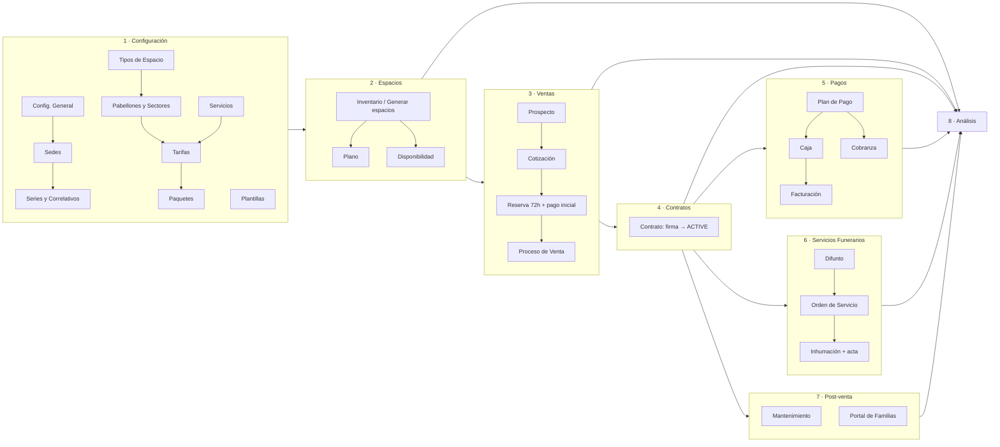

# Guía del flujo de Cementerio (Eternium) — de inicio a fin

> Para quien ya conoce la parte de partner-core (empresas, usuarios, roles) y necesita entender
> **en qué orden se cargan los datos de cementerio** y **cómo se encadenan los módulos**.
> Elaborada el 2026-09-26 leyendo el código (servicios, validaciones y pantallas). Las rutas de
> pantalla son las del tenant (`/cementerio/...`); las del grupo "Cementerio Sistema"
> (`/cementerio-sistema/...`, etiqueta SYS) son el mismo espejo para el Provider.
>
> Complemento: [`modulos-excel-vs-aplicacion.md`](modulos-excel-vs-aplicacion.md) explica por qué
> el menú no coincide 1 a 1 con el Excel.
> [`bitacora-ajustes.md`](bitacora-ajustes.md) registra las correcciones hechas al recorrer este flujo
> y los patrones de error que conviene revisar en otros módulos.
> [`incidencias.md`](incidencias.md) lista lo pendiente tras la evaluación completa del 2026-10-11.

---

## 0. El mapa en una imagen



**La idea central:** casi todo gira alrededor del **contrato ACTIVE**. Configuración y Espacios
preparan lo que se vende; Ventas lleva a un contrato; y solo con el contrato ACTIVE se habilita
lo demás: plan de pagos, inhumación, tareas de mantenimiento y acceso al portal.

```
Configurar → Crear espacios → Vender → Contrato ACTIVE ─┬─ Cobrar (Planes, Caja, Facturación, Cobranza)
                                                        ├─ Servicio funerario (Difunto → OS → Inhumación)
                                                        ├─ Mantenimiento (plan → tareas → evidencia)
                                                        └─ Portal de familias (el titular entra con DNI + código)
                                          Todo lo anterior → Análisis (dashboard, reportes, auditoría)
```

---

## 1. Antes de empezar (partner-core)

1. Una **empresa TENANT** con suscripción al producto (los módulos de Cementerio le aparecen).
2. Tu usuario con rol que tenga permisos en los módulos de Cementerio.
3. **Varios usuarios** si quieres probar todo: muchas aprobaciones exigen que apruebe **otra
   persona** (ver §10).
4. Para Mantenimiento: los usuarios que harán de operario, capataz y director.

### Datos de demo (solo perfil `dev`)

Si el backend arranca con perfil `dev`, ya existe el tenant **"Cementerio Jardines del Recuerdo"**
(RUC `20603058934`, usuario `demo@eternium.pe`) con:

| Viene sembrado | NO viene sembrado |
|---|---|
| Perfil legal con RUC validado y representante | Parámetros de sede (moneda, patrón de código) |
| Series de casi todos los tipos (QUOTATION, RESERVATION, SALE, PAYMENT…) | Series **CONTRACT** y **ACT_*** (actas) |
| 6 servicios con tarifa aprobada (Inhumación, Cremación…) | Tarifas de **tipos de espacio** |
| Pabellón «San José» con sectores, tipos (Nicho, Lote, Mausoleo) y espacios | Prospectos, contratos, pagos (todo lo operativo) |
| Plantilla de contrato publicada y plantilla de propuesta | |
| Checklist de transferencias y política de consentimiento del portal | |

> El seeder de espacios puede necesitar un **segundo arranque** del backend para completarse.
> Una empresa nueva en producción **no recibe nada de esto** salvo la plantilla de propuesta:
> hay que cargarlo todo con la fase 1.

---

## 2. FASE 1 — Configuración (una sola vez)

Orden recomendado. Entre paréntesis, lo que falla si te lo saltas.

| # | Pantalla | Qué registrar | Por qué importa |
|---|---|---|---|
| 1 | **Configuración General → Datos** | RUC, dirección fiscal, **representante legal** | Aparecen en contratos y actas. Sin representante, el contrato falla con `ETN_TPL_UNRESOLVED_VARS`. La validación SUNAT del RUC hoy es simulada: se marca a mano. |
| 2 | **Sedes** | Cada sede (nombre, código, dirección) | Casi todo es por sede. |
| 3 | **Configuración General → Parámetros** (por sede) | **Moneda**, zona horaria, sede operativa, nombres de niveles, **patrón de código de espacio** | Sin moneda guardada, los espacios generados salen sin moneda y sin tarifa la cotización falla. Una sede **no operativa** no puede emitir nada. |
| 4 | **Series y Correlativos** | Una serie por **sede × tipo de documento** | Si falta, falla **al emitir** con `ETN_SEQUENCE_MISSING`. Mínimo: QUOTATION, RESERVATION, SALE, **CONTRACT**, PAYMENT, RECEIPT, PAYMENT_PLAN, SERVICE_REQUEST, SERVICE_QUOTATION, SERVICE_ORDER, **ACT_INTERMENT/EXHUMATION/CREMATION/TRANSFER**, CEREMONY_EVENT, WORK_ORDER, PORTAL_REQUEST. Tras emitir el primer número, la serie queda bloqueada para edición. |
| 5 | **Tipos de Espacio** | Nombre, **familia física** (NICHE, GROUND, MAUSOLEUM…), capacidad máxima | La familia debe ser compatible con el tipo de sector (un nicho no va en un jardín de lotes). |
| 6 | **Pabellones y Sectores** | Pabellón → sectores (tipo de sector, grilla filas×columnas, **tipo de espacio por defecto**, precio por defecto, estado **OPERATIONAL**) | Si el sector no está OPERATIONAL, sus espacios nacen DISABLED. Solo se generan espacios en sectores "hoja" (sin sub-sectores). |
| 7 | **Tipos de Espacio** (otra vez) | Asignar los pabellones al tipo | Tipo y pabellón se referencian mutuamente; es necesario para tarifas por pabellón. |
| 8 | **Tarifas → pestaña Espacios** | Precio por tipo (y opcionalmente por pabellón), vigencia → **Aprobar** | **Una tarifa no aprobada no se usa.** Es inmutable una vez aprobada; para cambiar precio se crea otra con nueva vigencia. |
| 9 | **Servicios** | Inhumación, exhumación, cremación, mantenimiento… + requisitos + compatibilidad con tipos | El servicio **no lleva precio**: el precio va en Tarifas. |
| 10 | **Tarifas → pestaña Servicios** | Precio por servicio y sede → **Aprobar** | Hazlo **antes** de los paquetes. |
| 11 | **Paquetes** (opcional) | ≥ 2 servicios, precio, vigencia → Publicar | El precio de cada componente se congela desde la tarifa aprobada. Sin tarifas, publicar exige un motivo de excepción. |
| 12 | **Plantillas de Documentos** | Publicar **una sola** plantilla de contrato por sede; opcional: propuesta, recibo, OS | Sin plantilla: `ETN_CONTRACT_NO_TEMPLATE`. Con **varias** publicadas, el botón de Ventas falla (`ETN_CONTRACT_TEMPLATE_AMBIGUOUS`) porque no deja elegir. |

Licencias y horarios (pestañas de Configuración General) son informativos: ningún otro módulo los exige.

---

## 3. FASE 2 — Espacios (el inventario vendible)

| Pantalla | Para qué | Notas |
|---|---|---|
| **Inventario de Espacios** | Alta individual, importación Excel, o el asistente **"Generar espacios"** desde un sector (crea toda la grilla de golpe) | Generar exige tipo por defecto en el sector y permiso **Inventario → Crear**. Cada espacio recibe código y QR. Si no lleva pabellón queda "huérfano": existe pero no sale en el plano. |
| **Plano Interactivo** | Ver pabellón/sector con colores por estado; cambio de estado en lote | Solo dibuja espacios con posición (fila/columna o nodo SVG). |
| **Disponibilidad y Bloqueos** | Búsqueda comercial (solo AVAILABLE) y bloqueo temporal de 72 h | Mientras dura el bloqueo, el espacio queda RESERVED. |
| **Historial de Espacios** | Línea de tiempo de solo lectura (auditoría) | Se llena solo; exporta a PDF con hash. |

**Estados de un espacio:**

```
AVAILABLE ──(reserva/bloqueo)──► RESERVED ──(contrato ACTIVE)──► OCCUPIED
    ▲  │                            │ (vence/libera)
    │  └──► MAINTENANCE / DISABLED  ▼
    └──────────────────────────── AVAILABLE
```

`RESERVED` y `OCCUPIED` **no se ponen a mano**: los ponen la reserva y el contrato.

✅ **Chequeo de fin de fase:** en Disponibilidad aparece al menos un espacio AVAILABLE con precio (tarifa aprobada, o precio y moneda del propio espacio).

---

## 4. FASE 3 — Ventas → Contrato (el camino feliz)

Esta es la columna vertebral. Paso a paso, con el botón exacto:

| # | Pantalla → acción | Resultado | Requisito clave |
|---|---|---|---|
| 1 | **Ventas / Prospectos (CRM) → Agregar** | Prospecto | Consentimiento (Ley 29733); documento no duplicado |
| 2 | *(opcional)* **Ventas / Pipeline → Nueva oportunidad** | Tarjeta en el kanban | Solo seguimiento; no crea nada más |
| 3 | *(opcional)* **Contratos / Titulares → Agregar** con **el mismo documento** | Titular ya registrado; la venta se vinculará a él | Ya no hace falta: «Generar contrato» pide lo que falte. Ver ⚠️ más abajo |
| 4 | **Ventas / Cotización → Agregar → "Emitir en firme"** | Cotización ISSUED (15 días de vigencia) | Espacio AVAILABLE con precio. Si el descuento supera el límite del rol, la cotización queda «Descuento por aprobar» y hay que aprobarla antes de emitir (puede hacerlo el mismo usuario que la creó). Crear no es emitir. |
| 5 | **Ventas / Reserva → Nueva reserva** (desde la cotización) | Reserva ACTIVE, espacio RESERVED, reloj de 72 h | Cotización vigente en firme |
| 6 | **Reserva → Registrar pago inicial** | Reserva CONFIRMED (el reloj se detiene) | Monto ≥ mínimo (10 % o cuota inicial del plan simulado). **No pasa por Caja.** |
| 7 | **Reserva → Validar pago** | Pago VALIDATED | Sin esto no se puede abrir la venta |
| 8 | **Ventas / Proceso de Venta → Nuevo expediente** | Venta; reserva CONVERTED | Reserva CONFIRMED + pago validado |
| 9 | **Checklist → Vincular/Subir → Verificar** cada documento | Checklist completo | Si no configuraste requisitos (botón "Requisitos"), cuenta como completo |
| 10 | **"Generar contrato"** (tenencia/plazo) → si al titular le falta algo, formulario **«Completar datos del titular»** | Crea o vincula el **titular** (desde el prospecto), le guarda los datos completados y crea el **contrato en PENDING_SIGNATURE** | Serie CONTRACT, una plantilla publicada |
| 11 | **Contratos / Contratos de Titularidad → detalle → Firmar** (cada firmante) | Contrato **ACTIVE**, espacio **OCCUPIED**, escritura en Gestión Documental | El último firmante es el usuario que envió a firma (representante del cementerio) |
| 12 | **Proceso de Venta → "Asignar definitivamente"** | Venta ASSIGNED, comisión, oportunidad Ganada | Contrato ACTIVE |

⚠️ **Trampas de Ventas**

- **El contrato sale directo a firma.** Después ya no se pueden añadir cotitulares ni beneficiarios,
  porque eso solo se permite en borrador. Si los necesitas, usa el contrato directo (abajo).
- El titular promovido desde el prospecto solo copia teléfono y email. Si la plantilla usa
  `{{titular.direccion}}`, `{{titular.telefono}}` o `{{titular.email}}` y ese dato falta, o el titular
  es persona jurídica (necesita representante con poder vigente), **«Generar contrato» abre el
  formulario «Completar datos del titular»** con solo lo que falta (dirección, email/teléfono,
  representante legal: nombre, documento y vigencia del poder) y lo guarda en la ficha del titular
  al generar. Crear antes el titular en Contratos → Titulares con el mismo documento es **opcional**
  (la venta se vincula a él). Si no hay plantilla publicada o hay varias, el mismo modal lo avisa.
- El plan simulado en la cotización **no** se convierte solo en el plan de pagos real: la cotización guarda
  lo pactado (cuota inicial, n.º de cuotas, tasa), pero la deuda con cuotas y mora se crea aparte, en la
  Fase 4 (Pagos → Planes de Pago), volviendo a ingresar esos datos.

**Atajo — contrato directo sin venta:** `Contratos / Titulares → Agregar` → `Contratos de Titularidad
→ Agregar` (espacio no reservado, titular, tenencia, precio, moneda, plantilla; aquí sí puedes añadir
cotitulares y beneficiarios en borrador) → **Enviar a firma** → **Firmar**. No genera venta, comisión
ni pipeline. Es la forma más rápida de tener un contrato ACTIVE para probar las fases siguientes.

**Otras pantallas de Contratos**

- **Gestión Documental:** repositorio de documentos enlazados a contrato, espacio o titular, con versiones. Las escrituras llegan solas.
- **Transferencias y Renovaciones:**
  - **Transferencia:** contrato ACTIVE, nuevo titular ya creado, deuda en cero, checklist y firma de ambos titulares. Crea una copia ACTIVE del contrato a nombre del nuevo titular.
  - **Renovación:** solo para contratos no perpetuos.

---

## 5. FASE 4 — Pagos (después del contrato ACTIVE)

**Camino feliz: cobrar una cuota**

1. *(Antes de crear el plan)* configurar la **mora** por sede en **Pagos → Planes de Pago → botón «Tasas de mora»**
   (en la cabecera del módulo). Se congela al crear el plan; si no existe, la mora es 0.

   | Campo | Qué significa | Ejemplo |
   |---|---|---|
   | Sede | A qué sede aplica; «Todas las sedes» sirve de valor general. | Todas las sedes |
   | Concepto | A qué deuda aplica (venta de espacio, servicio, mantenimiento perpetuo, otro) o «Todos los conceptos». | Todos los conceptos |
   | Tipo de tasa | Si la tasa es **por día** o **por mes** de atraso. La mensual se divide entre 30 al congelarla. | diaria |
   | Tasa | % que se cobra sobre el **saldo vencido** por cada día (o mes) de atraso. | 0.05 (= 0,05 % diario) |
   | Máximo legal | Techo de la tasa según la ley o el contrato; la tasa no puede superarlo (lo valida la BD). | 0.10 |
   | Días de gracia | Días después del vencimiento en que todavía **no** corre mora (0 a 90). | 5 |
   | Tope de mora | La mora acumulada de una cuota nunca pasa de este % de su saldo vencido. Vacío = sin tope. | 20 |
   | Mora primero tras | Días de atraso a partir de los cuales un pago cubre **primero la mora** y luego el capital (antes, primero capital). | 60 |
   | Vigente desde / hasta | Periodo de validez; «hasta» vacío = sin fin. No puede haber dos periodos solapados para la misma sede y concepto. | 01/10/2026 – vacío |

   Ejemplo: cuota de S/ 100 vencida hace 15 días con tasa 0.05 % diaria y 5 días de gracia → corre mora 10 días
   → 100 × 0,05 % × 10 = S/ 0.50.
2. **Pagos / Planes de Pago → simular → crear.** Plan de 2 a 60 cuotas sobre un contrato ACTIVE. Es **manual**: no se crea solo al vender.
3. **Pagos / Caja y Pagos:**
   - Crear el **punto de cobro** de la sede.
   - **Abrir la sesión (turno)**. Sin sesión abierta el cobro falla (`ETN_PAY_NO_SESSION`).
4. **Registrar el pago** con canal Caja y medio de pago. Se aplica a las cuotas y se emite el recibo interno; el excedente queda como crédito.
5. *(Opcional)* **Facturación Electrónica → "Emitir desde pago"** (boleta o factura).
   - **No es automático** en caja.
   - Hoy está en **modo simulado** (`eternium.sunat.stub=true`): acepta con un CDR ficticio y no llega a SUNAT. El proveedor real previsto es el **facturador externo**.
6. **Cerrar la sesión** con arqueo; si hay descuadre, justificarlo. El cierre diario se genera a las 02:00.
7. *(Después)*
   - **Conciliación Bancaria:** importar el extracto del banco.
   - **Reportes Financieros:** el pago aparece tras el refresco nocturno (06:00–07:00), no al instante.

**Cobranza y Morosos** no requiere cargar nada. Se alimenta sola de las cuotas vencidas (job de las 06:00):

- **Alertas escalonadas:** email el día 1, SMS el día 3, WhatsApp el día 7.
- **Bloqueo:** a los 60 días. Bloquea solicitudes del portal y transferencias, pero **no** servicios funerarios (ahí solo hay un aviso, por criterio humanitario).

---

## 6. FASE 5 — Servicios Funerarios (cuando fallece alguien)

**Requisitos previos:**

- Contrato **ACTIVE** sobre el espacio, que no esté en mantenimiento ni deshabilitado y **con capacidad libre**.
- Servicios con tarifa aprobada.
- Series SERVICE_* y ACT_*.
- Capillas y Salas, si habrá sepelio.

| # | Pantalla → acción | Resultado | Requisito clave |
|---|---|---|---|
| 1 | **Difuntos → Agregar** (borrador) → subir **certificado de defunción** → agregar **familiar principal** → **Confirmar** | Difunto CONFIRMED | El borrador **vence a las 72 h**: confirma el mismo día |
| 2 | **Órdenes de Servicio → nueva solicitud** (tipo INHUMATION, difunto, contrato). El **contrato elige el espacio** (se ve como «CON-… · titular · espacio (ocupados/capacidad)»); con vínculo Titular o Beneficiario los datos del solicitante se completan solos | Solicitud RECEIVED | Cuotas vencidas o falta de contrato solo **avisan**, no bloquean. Saldo sin atraso = «Al día con saldo» |
| 3 | → **crear cotización → aprobarla** | Solicitud PENDING_APPROVAL | Cotización vigente (15 días) |
| 4 | → en el detalle de la solicitud, paso **«Aprobación» → Aprobar** (también Observar / Rechazar) | Solicitud APPROVED | Difunto CONFIRMED con certificado válido. Sin este paso **no** se puede crear la OS |
| 5 | → **generar OS** desde la cotización → completar checklist → **Emitir** | OS ISSUED | Eximir un requisito lo hace otro usuario; OS mayor a S/ 15 000 exige un segundo aprobador |
| 6 | *(si hay sepelio)* otra solicitud + OS de tipo **CEREMONY** → **Agenda de Ceremonias → Sepelio → confirmar con sala** | Evento CONFIRMED | La sala debe existir en **Capillas y Salas** con horario |
| 7 | **Inhumaciones y Exhumaciones → Ejecutar inhumación** | **Acta** con correlativo y hash; ocupación +1; difunto INTERRED; OS EXECUTED; evento en el historial; aviso al titular | Contrato ACTIVE en **ese** espacio, capacidad libre |
| 8 | **Agenda → cerrar sepelio** (con acta y certificado) | Evento CLOSED | |

**Otras rutas:**

- **Exhumación:**
  - Requiere 365 días desde la inhumación, salvo excepción sanitaria.
  - Requiere autorización legal validada.
  - Requiere **dos validaciones del director hechas por usuarios distintos**.
- **Cremación:**
  - OS de tipo CREMATION.
  - Si la muerte fue violenta, oficio fiscal.
  - Luego se emite la urna, se asigna su destino y se entrega.
- **Traslado:**
  - Interno o externo, con OS de tipo TRANSFER.
  - El **externo** exige un **Permiso Municipal** en estado VALID. Hoy se valida en **modo MANUAL**; el modo API no está conectado.
  - Exige tres conformidades.

> Nota: las actas son registros con hash; hoy no se renderizan como PDF desde una plantilla.

---

## 7. FASE 6 — Mantenimiento

Orden: **Configuración → Programación → Tareas → Ejecución → Supervisión → Historial**.

1. **Configuración de Mantenimiento:**
   - **Personal:** vincula usuarios de la empresa con el rol interno Operario, Capataz o Director. No es un rol de seguridad de partner-core.
     - **Para probar basta tu usuario como Operario:** la ejecución queda siempre a nombre del operario asignado; la registra él o un capataz/director en su nombre (otro operario no puede). Asignar y aprobar en Supervisión piden permiso del módulo, no rol. Capataz y Director corrigen ejecuciones enviadas y reciben alertas.
     - Un usuario tiene un solo rol por sede; si te equivocaste, edita la ficha.
   - **Plantillas de checklist.**
   - **Geocerca por sede:** círculo (centro + radio) que rodea el predio. Las fotos tomadas fuera no se bloquean, pero quedan marcadas. Centro: cópialo de Google Maps o usa «Usar mi ubicación»; radio: hasta el borde más lejano (300–500 m es habitual).
   - **Infraestructura común:** lo que se mantiene y no se vende (jardines, vías, rejas). El tipo «Pabellón» es la estructura de un pabellón que ya existe: se elige de la lista, no se crea otro.
   - **Umbrales:** solo lectura; muestra los valores que rigen para la empresa.
   - Las frecuencias se crean solas.
   - **Días de trabajo de la cuadrilla** (pestaña Umbrales): si se trabaja domingos y/o feriados. En un día no laborable un plan diario no genera tarea; uno semanal o mayor pasa al siguiente día hábil.
2. **Programación de Mantenimiento:** plan sobre espacios o infraestructura común, con frecuencia, turno, fechas y **checklist obligatorio**.
   - Un plan de espacios crea **una tarea por espacio y por periodo**, por eso exige un **pabellón** (o un sector); dentro de él, sector y tipo «Todos» cubren todo el pabellón. La limpieza general del predio va como Infraestructura común.
   - «Frecuencia del plan seleccionado» es un **simulador**: elige un plan en la tabla y prueba frecuencias para ver cuántas tareas al año generaría, sin cambiar el plan.
3. **Tareas:** las genera un job a las **00:30**, o a demanda con **«Ejecutar generación ahora»** (Programación → Planes preventivos).
   - Aparecen en la pestaña **«Asignación del día»** (por fecha), donde se asignan a un operario.
   - **«Calendario»** muestra el mes con cuántas tareas hay cada día por estado; al hacer clic en un día se listan sus tareas. Las tareas **previstas** de los planes (aún no generadas) se ven con borde punteado.
   - Si el servidor no corrió algún día a las 00:30, «Ejecutar generación ahora» recupera los días perdidos (hasta 7).
   - ⚠️ Solo genera tarea un espacio **vendido con contrato ACTIVE**; si el plan tiene «Exigir mantenimiento perpetuo», además un plan de pago de concepto **«Mantenimiento perpetuo»** (Pagos → Planes de pago → Nuevo). El panel «Cobertura contractual» del plan dice cuántos espacios generan tarea y por qué quedan fuera los demás; si la corrida da «0 tareas generadas», mira ahí.
   - Luego el capataz asigna cada tarea a un operario de la misma sede con capacidad.
4. **Ejecución en Campo → Registrar ejecución:** solo se listan tareas **ya asignadas** a un operario (asignadas, en curso o vencidas). La ejecución queda a nombre de ese operario (no se elige).
   - Paso 1 datos y checklist; paso 2 evidencia (foto ANTES y DESPUÉS obligatorias, hasta 5 adicionales y notas de voz ≤ 60 s, cuya duración se lee del archivo); paso 3 revisar el checklist y enviar.
   - Los ítems **obligatorios** del checklist se exigen al enviar. Una foto o un audio subido por error se quita con la ✕ mientras el registro sea borrador.
   - «Guardar borrador» cierra sin enviar; se retoma con **«Continuar registro»** en la ficha (o al volver a registrar la misma tarea).
5. **Supervisión y Control:**
   - **Aprobar:** crea una intervención en el Historial, añade un evento al historial del espacio y la muestra en el portal.
   - **Rechazar:** crea una tarea de retrabajo para el mismo operario.
   - **Alertas:** una tarea vencida sin operario solo genera «sin asignar»; las reprogramaciones por encima del umbral alertan al Capataz.
   - **Cumplimiento por pabellón:** tareas hechas a tiempo sobre las del mes ya vencidas o terminadas (las que aún no vencen no cuentan). Al hacer clic en un pabellón se ve el rendimiento de su cuadrilla.
6. **Historial de Infraestructura:** intervenciones, órdenes correctivas e índice de conservación.

---

## 8. FASE 7 — Portal de Familias

### 8.1 El portal público (sí existe)

No aparece en el menú lateral porque es otra interfaz, para las familias.

| Entorno | URL |
|---|---|
| Local (dev) | `http://localhost:4200/portal/20603058934/acceso` (tenant demo) |
| Desplegado | `https://<dominio-del-frontend>/portal/<RUC-de-la-empresa>/acceso` — p. ej. `https://uat.eternium.partnertech.pe/portal/<RUC>/acceso` |
| Sin RUC | `/portal` → pide el RUC y redirige |

**Qué debe existir antes (en el back-office):**

1. Un **titular** (o cotitular o beneficiario) con documento DNI, CE, pasaporte o RUC.
2. **Un contacto EMAIL** en la ficha del titular. Sin correo, el portal responde "acércate a la oficina". Los beneficiarios que no son titulares no tienen correo, así que no pueden entrar.
3. Un **contrato con espacio** en estado ACTIVE, PENDING_SIGNATURE o EXPIRED.
4. **No hace falta crear la cuenta**: se crea sola la primera vez que la persona pide el código. Opcionalmente, **Cuentas del Portal → "Invitar titular"** le envía un correo; el correo no lleva enlace, dice "entra con tu documento y el RUC".

**Cómo entra la familia:**

1. Abre la URL.
2. Elige el tipo de documento y escribe el número.
3. Recibe **por correo un código de 6 dígitos**, válido 5 minutos.
4. Escribe el código.
5. Acepta el consentimiento, si la empresa publicó una política.
6. Llega a Inicio.

- **Límites:** reenvío cada 30 s; 5 intentos; bloqueo de 15 min; la sesión expira a los 20 min de inactividad.
- ⚠️ **Para probarlo necesitas recibir el correo.** No hay código fijo de desarrollo ni se imprime en el log.
  - **En local**, el SMTP por defecto es MailHog (`mailhog:1025`): levanta MailHog y lee el correo en su interfaz web.
  - **En UAT/prod** el correo sale por SendGrid, así que el titular debe tener **un correo real al que tengas acceso**.

**Qué puede hacer dentro:**

- **Ver sus espacios:** conservación, fotos de mantenimiento, inhumaciones.
- **Pagar cuotas:** siempre las más antiguas primero. Usa la pasarela configurada; en dev es un simulador.
- **Descargar documentos:** los sensibles solo los ve el titular.
- **Crear solicitudes.**

El titular y su representante pueden pagar y solicitar; cotitulares y beneficiarios solo pueden consultar.

### 8.2 El back-office (lo del menú)

| Pantalla | Para qué |
|---|---|
| **Atención al Titular** | Bandeja de solicitudes que llegan del portal: asignar, responder, resolver, cerrar (SLA vigilado cada 15 min) |
| **Cuentas del Portal** | Ver cuentas (vacía hasta que alguien entra o se invita), vínculos, sesiones; bloquear; revocar acceso; **Invitar titular** |
| **Tipos de Solicitud** | Catálogo con SLA y costo; se siembra solo la primera vez |
| **Pasarelas de Pago** | Una pasarela habilitada por empresa (Culqi o el simulador) |
| **Consentimientos** | Publicar la política; una versión nueva obliga a todos a re-aceptar |

---

## 9. FASE 8 — Análisis (solo lectura)

| Pantalla | De dónde salen los datos |
|---|---|
| **Dashboard Ejecutivo** | Vistas materializadas refrescadas **cada 15 min**: en un entorno nuevo puede verse vacío un rato |
| **Reportes** | Catálogo de reportes, generación en cola y envíos programados |
| **Auditoría** | Bitácora de acciones, trazabilidad por contrato, cambios en datos de difuntos |

---

## 10. Aprobaciones que exigen **otro usuario**

Para probarlas necesitas al menos **dos usuarios** con permisos:

- Anulación de venta (dos aprobadores distintos).
- Refinanciación de un plan de pagos, anulación de un pago, NC/ND > 1 UIT.
- Excepción de cobranza, revisión de incobrable.
- Anulación del expediente de un difunto.
- Eximir un requisito de la OS, OS > S/ 15 000.
- Exhumación (doble validación del director).

Sin segundo usuario: aprobar tarifas, publicar paquetes y plantillas, y validar el pago inicial de una reserva.

---

## 11. Procesos automáticos (hora de Lima)

| Cuándo | Qué hace |
|---|---|
| 00:00 | Calcula la mora de las cuotas vencidas |
| 00:10 | Snapshot diario de KPIs |
| 00:30 | Genera las tareas de mantenimiento |
| 02:00 | Genera el cierre de caja del día anterior |
| 03:15 | Concilia facturas en contingencia |
| 06:00 | Evalúa morosidad (alertas, bloqueos) y refresca reportes |
| 06:30 | Aviso de órdenes correctivas vencidas |
| 06:45 | Vence los borradores de difunto de más de 72 h |
| 07:00 | Escala excepciones de conciliación (> 48 h), refresco financiero, resumen de mantenimiento |
| Cada 5–15 min | Reintentos de facturación, alertas, KPIs, SLA del portal, vencimiento de reservas y bloqueos |

---

## 12. Errores frecuentes y su causa

| Error / síntoma | Causa | Dónde se arregla |
|---|---|---|
| `ETN_SEQUENCE_MISSING` | Falta la serie de ese tipo en esa sede | Configuración / Series y Correlativos |
| `ETN_QUOTE_NO_PRICE` | Sin tarifa **aprobada** vigente ni precio en el espacio | Tarifas (aprobar) o Parámetros de sede (moneda) |
| `ETN_CONTRACT_NO_TEMPLATE` / `…TEMPLATE_AMBIGUOUS` | Cero o varias plantillas de contrato publicadas | Plantillas de Documentos |
| `ETN_TPL_UNRESOLVED_VARS` | La plantilla usa un dato vacío (representante del cementerio, dirección del titular…) | Config. General (datos del cementerio). Los del titular los pide «Generar contrato» en «Completar datos del titular» |
| `ETN_POWER_EXPIRED` | Titular persona jurídica sin representante con poder vigente | «Completar datos del titular» al generar el contrato, o Titulares → representantes |
| `ETN_PAY_NO_SESSION` | Cobro en caja sin sesión abierta | Caja y Pagos → abrir sesión |
| `ETN_GRID_TYPE_REQUIRED` | Generar espacios sin tipo por defecto en el sector | Pabellones y Sectores |
| `ETN_RATE_PAVILION` | Tarifa por pabellón con un pabellón no asignado al tipo | Tipos de Espacio → asignar pabellón |
| Espacios nacen DISABLED | Sector no está OPERATIONAL | Pabellones y Sectores |
| No se generan tareas de mantenimiento | Espacios sin contrato ACTIVE, o plan sin checklist | Contratos / Programación |
| El familiar no puede entrar al portal | Titular sin email o sin contrato vivo con espacio | Titulares / Contratos |
| El pago no aparece en reportes | Aún no corre el refresco nocturno | Esperar al día siguiente |

---

## 13. Receta mínima para ver todo funcionando (tenant demo)

1. **Parámetros** de la sede principal: guardar la moneda (PEN).
2. **Series:** crear CONTRACT y ACT_INTERMENT (no vienen sembradas).
3. **Tarifas → Espacios:** crear y aprobar la tarifa del tipo "Nicho".
4. **Prospecto** → **Cotización** (emitir en firme) → **Reserva** → pago inicial → validar → **Venta** → Generar contrato → **Firmar** → Asignar.
5. En **Titulares**, poner al titular un **email real** que puedas leer.
6. **Portal:** abrir `/portal/20603058934/acceso` y entrar con el DNI del titular y el código recibido.
7. **Plan de Pagos** sobre ese contrato → **Caja** (punto de cobro, abrir sesión, cobrar) → ver la cuota pagada en el portal.
8. **Difunto** → **OS de inhumación** → **Ejecutar inhumación** → revisar el **Historial de Espacios** y el portal.
9. **Mantenimiento:**
   - Vincular un usuario como operario.
   - Crear un plan sobre ese espacio.
   - "Generar tareas", asignar, ejecutar con el operario y aprobar en Supervisión.
10. **Análisis:** ver el dashboard (tras ~15 min) y la auditoría.
