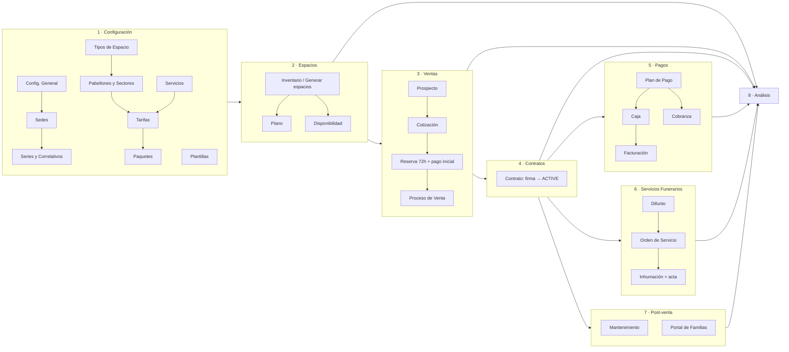

# Guía del flujo de Cementerio (Eternium) — de inicio a fin

> Para quien ya conoce la parte de partner-core (empresas, usuarios, roles) y necesita entender
> **en qué orden se cargan los datos de cementerio** y **cómo se encadenan los módulos**.
> Elaborada el 2026-09-26 leyendo el código (servicios, validaciones y pantallas) y revisada contra el
> código el 2026-11-17 (incidencias QA hasta la 70). Las rutas de
> pantalla son las del tenant (`/cementerio/...`); las del grupo "Cementerio Sistema"
> (`/cementerio-sistema/...`, etiqueta SYS) son el mismo espejo para el Provider.
>
> Complemento: [`modulos-excel-vs-aplicacion.md`](modulos-excel-vs-aplicacion.md) explica por qué
> el menú no coincide 1 a 1 con el Excel.
> [`bitacora-ajustes.md`](bitacora-ajustes.md) registra las correcciones hechas al recorrer este flujo
> y los patrones de error que conviene revisar en otros módulos.
> [`incidencias.md`](incidencias.md) lista lo pendiente tras la evaluación completa del 2026-10-11, y
> [`incidencias-qa.md`](incidencias-qa.md), las incidencias reportadas por QA en UAT.

---

## 0. El mapa en una imagen



**La idea central:** casi todo gira alrededor del **contrato ACTIVE**. Configuración y Espacios
preparan lo que se vende; Ventas lleva a un contrato; y solo con el contrato ACTIVE se habilita
lo demás: plan de pagos, inhumación, tareas de mantenimiento y acceso al portal.

```
Configurar → Crear espacios → Vender → Contrato ACTIVE ─┬─ Cobrar (Planes, Caja, Facturación, Cobranza)
                                                        ├─ Servicio funerario (Difunto → OS → Inhumación)
                                                        ├─ Mantenimiento (plan → tareas → evidencia)
                                                        └─ Portal de familias (el titular entra con DNI + código)
                                          Todo lo anterior → Análisis (dashboard, reportes, auditoría)
```

---

## 1. Antes de empezar (partner-core)

1. Una **empresa TENANT** con suscripción al producto (los módulos de Cementerio le aparecen).
2. Tu usuario con rol que tenga permisos en los módulos de Cementerio.
3. **Varios usuarios** si quieres probar todo: muchas aprobaciones exigen que apruebe **otra
   persona** (ver §10).
4. Para Mantenimiento: los usuarios que harán de operario, capataz y director.

### Datos de demo (solo perfil `dev`)

Si el backend arranca con perfil `dev`, ya existe el tenant **"Cementerio Jardines del Recuerdo"**
(RUC `20603058934`, usuario `demo@eternium.pe`) con:

| Viene sembrado | NO viene sembrado |
|---|---|
| Perfil legal con RUC validado y representante | Parámetros de sede (moneda, patrón de código) |
| Series de casi todos los tipos (QUOTATION, RESERVATION, SALE, PAYMENT…) y, en Facturación, F001/B001 en cada sede operativa | Las series que faltan (CONTRACT, ACT_*…) se crean solas al emitir el primer documento |
| 6 servicios con tarifa aprobada (Inhumación, Cremación…) | Tarifas de **tipos de espacio** |
| Pabellón «San José» con sectores, tipos (Nicho, Lote, Mausoleo) y espacios | Prospectos, contratos, pagos (todo lo operativo) |
| Plantilla de contrato publicada y plantilla de propuesta | |
| Checklist de transferencias y política de consentimiento del portal | |

> El seeder de espacios puede necesitar un **segundo arranque** del backend para completarse. Con otro perfil
> (p. ej. `qa`) no se siembra nada.
> Una empresa nueva en producción **no recibe nada de esto** salvo las plantillas de contrato y de propuesta
> (de empresa, para todas las sedes) y las series, que se crean al emitir: lo demás se carga con la fase 1.

---

## 2. FASE 1 — Configuración (una sola vez)

Orden recomendado. Entre paréntesis, lo que falla si te lo saltas.

| # | Pantalla | Qué registrar | Por qué importa |
|---|---|---|---|
| 1 | **Configuración General → Datos** | RUC, dirección fiscal, **representante legal** | Aparecen en contratos y actas. Sin representante, el contrato falla con `ETN_TPL_UNRESOLVED_VARS`. «Verificar RUC» consulta el padrón de SUNAT (vía Factiliza) si el servidor no está en modo simulado, y deja el RUC validado o rechazado. En modo simulado (el de por defecto), o si el padrón no responde, no verifica nada: comprueba el RUC en el portal de SUNAT y usa «Marcar como validado». Aquí también se registra la **llave del facturador** (sin ella no se emiten comprobantes electrónicos reales, ver §5). |
| 2 | **Sedes** | Cada sede (nombre, código, dirección, RUC propio) y su **moneda** al crearla | Casi todo es por sede. «Editar» corrige los datos base; los parámetros se cambian en el paso 3. El RUC se valida (11 dígitos, prefijo y dígito verificador) y el teléfono debe tener de 6 a 9 dígitos. |
| 3 | **Configuración General → Parámetros** (por sede) | **Moneda** (obligatoria), zona horaria, sede operativa, nombres de niveles, **patrón de código de espacio** (al menos un token) | Cambiar la moneda afecta a lo que se cree desde entonces; lo registrado conserva la suya. Una sede **no operativa** no puede emitir nada ni tener series, y deja de aparecer en las pantallas de trabajo (ventas, contratos, pagos, mantenimiento…); solo Configuración, informes y auditoría la siguen mostrando. |
| 4 | **Series y Correlativos** (opcional) | Una serie por **sede × tipo de documento**. Se elige la sede en el filtro de la tabla | No hace falta crearlas: si la sede no tiene serie de un tipo, se crea sola al emitir el primer documento, con el prefijo base y el primer número libre de la empresa (COT1, COT2…, 7 dígitos). Aquí se edita el prefijo o el formato **antes** de la primera emisión; tras emitir el primer número, la serie queda bloqueada para edición. Las sedes no operativas no aparecen aquí. Las series de boleta y factura son aparte (Facturación, §5). |
| 5 | **Tipos de Espacio** | Nombre, **familia física** (nicho, tierra, mausoleo…), capacidad máxima | La familia debe ser compatible con la tipología del sector (un nicho no va en un jardín de lotes). |
| 6 | **Pabellones y Sectores** | Pabellón → sectores (tipología, grilla filas×columnas, **tipo de espacio por defecto**, precio por defecto, construcción **operativa**) → en el sector hoja, **«Generar espacios»** | Si el sector no está operativo, sus espacios nacen deshabilitados. Solo se generan espacios en sectores «hoja» (sin sub-sectores), con un tipo de familia compatible y como máximo 20 000 celdas. |
| 7 | *(ya no hace falta)* | — | Al crear la tarifa por pabellón, el tipo queda vinculado a ese pabellón (si alguno de sus sectores admite la familia). |
| 8 | **Tarifas → pestaña Espacios** | Precio por tipo (y opcionalmente por pabellón), vigencia → **Aprobar** | **Una tarifa no aprobada no se usa.** Va en la moneda de la sede y su vigencia empieza hoy o después: apruébala antes de que empiece. Es inmutable una vez aprobada: para cambiar el precio usa **«Nuevo precio»** (al aprobarse, la anterior se cierra el día previo) o **«Cerrar vigencia»**. No puede haber dos tarifas del mismo concepto con vigencias cruzadas. Una rechazada se puede **corregir y reenviar**. El precio de lista de los espacios sale de esta tarifa. |
| 9 | **Servicios** | Inhumación, exhumación, cremación, mantenimiento… + requisitos (documento de referencia opcional) + compatibilidad con tipos (informativa) | El servicio **no lleva precio**: el precio va en Tarifas. |
| 10 | **Tarifas → pestaña Servicios** | Precio por servicio y sede → **Aprobar** | Hazlo **antes** de los paquetes. Mismas reglas de vigencia que en la pestaña Espacios. |
| 11 | **Paquetes** (opcional) | ≥ 2 servicios, precio, vigencia → Publicar | El precio de cada componente se toma **al publicar** desde la tarifa aprobada vigente. Sin tarifa de algún componente, o con precio mayor a la suma, publicar exige un motivo de excepción. |
| 12 | **Plantillas de Documentos** (opcional) | Ya vienen publicadas, de empresa (valen para todas las sedes), la de contrato («Contrato de cesión de derechos de uso - Estándar») y la de propuesta. Se editan con una versión nueva; si se borraron, el botón **«Plantilla estándar»** las vuelve a crear como borrador | Solo puede haber **una publicada por tipo, idioma y alcance** (sede o toda la empresa): publicar otra igual se rechaza; para reemplazarla, envía la vigente a la papelera y publica la otra. La de la sede tapa a la de la empresa. Si quedan varias (compra, arrendamiento…), Ventas deja elegir. |

Licencias y horarios (pestañas de Configuración General) son informativos: ningún otro módulo los exige.

---

## 3. FASE 2 — Espacios (el inventario vendible)

| Pantalla | Para qué | Notas |
|---|---|---|
| **Inventario de Espacios** | Alta individual, importación Excel, o el asistente **"Generar espacios"** desde un sector (crea toda la grilla de golpe) | Generar exige tipo por defecto en el sector y permiso **Inventario → Crear**. Cada espacio recibe código y QR. En el alta individual el precio de lista no se escribe: sale de la tarifa aprobada vigente del tipo (la del pabellón o la general); sin tarifa, el espacio queda sin precio. Al elegir el tipo solo se ofrecen pabellones y sectores compatibles. Si no lleva pabellón queda "huérfano": existe pero no sale en el plano. |
| **Plano Interactivo** | Ver pabellón/sector con colores por estado; cambio de estado en lote | Solo dibuja espacios con posición (fila/columna o nodo SVG). |
| **Disponibilidad y Bloqueos** | Búsqueda comercial (solo AVAILABLE, con el precio que cotiza el contrato) y bloqueo temporal (72 h por defecto; la empresa lo configura) | Mientras dura el bloqueo, el espacio queda RESERVED; el bloqueo se cierra solo al crear el contrato o se libera a mano. |
| **Historial de Espacios** | Línea de tiempo de solo lectura (auditoría) | Se llena solo; exporta a PDF con hash. |

**Estados de un espacio:**

```
AVAILABLE ──(reserva/bloqueo)──► RESERVED ──(contrato ACTIVE)──► OCCUPIED
    ▲  │                            │ (vence/libera)
    │  └──► MAINTENANCE / DISABLED  ▼
    └──────────────────────────── AVAILABLE
```

`RESERVED` y `OCCUPIED` **no se ponen a mano**: los ponen la reserva y el contrato.

✅ **Chequeo de fin de fase:** en Disponibilidad aparece al menos un espacio AVAILABLE con precio (el precio sale de la tarifa aprobada vigente de su tipo).

---

## 4. FASE 3 — Ventas → Contrato (el camino feliz)

Esta es la columna vertebral. Paso a paso, con el botón exacto:

| # | Pantalla → acción | Resultado | Requisito clave |
|---|---|---|---|
| 1 | **Ventas / Prospectos (CRM) → Agregar** | Prospecto | Consentimiento (Ley 29733) con una **política de datos publicada** en Portal de Familias → Consentimientos (sin ella no se puede registrar ni prospecto ni titular); mayor de 18 años; documento no duplicado |
| 2 | *(opcional)* **Ventas / Pipeline → Nueva oportunidad** | Tarjeta en el kanban | Solo seguimiento; no crea nada más. El tablero se filtra por vendedor; «Conversión» muestra cuántas oportunidades pasan de una etapa a otra; en «Metas y tarifario» se definen las metas (por sede o por vendedor) y las **reglas de comisión** |
| 3 | *(opcional)* **Contratos / Titulares → Agregar** con **el mismo documento** | Titular ya registrado; la venta se vinculará a él | Ya no hace falta: «Generar contrato» pide lo que falte. Ver ⚠️ más abajo |
| 4 | **Ventas / Cotización → Agregar → "Emitir en firme"** | Cotización ISSUED (15 días de vigencia) | Espacio AVAILABLE con precio. El asistente muestra el total **con IGV** que se va a congelar. Si el descuento supera el límite del rol, la cotización queda «Descuento por aprobar» y hay que aprobarla antes de emitir (puede hacerlo el mismo usuario que la creó). Crear no es emitir. Si el espacio no estaba disponible, sale **«Referencial»**: sirve de precio pero no deja reservar (clónala en firme). El descuento debe ser menor al 100 % (una cotización no puede quedar en cero) y la inicial del plan simulado también. |
| 5 | **Ventas / Reserva → Nueva reserva** (desde la cotización) | Reserva ACTIVE, espacio RESERVED, reloj con el plazo configurado (72 h por defecto) | Cotización emitida o aceptada, vigente y **en firme** |
| 6 | **Reserva → Registrar pago inicial** | Reserva CONFIRMED (el reloj se detiene) | Monto ≥ mínimo (10 % o cuota inicial del plan simulado). **No pasa por Caja.** |
| 7 | **Reserva → Validar pago** | Pago VALIDATED | Sin esto no se puede abrir la venta. Una reserva con pago recibido (CONFIRMED) ya **no se libera**: sigue a la venta o a una anulación formal |
| 8 | **Ventas / Proceso de Venta → Nuevo expediente** (o «Ir al proceso de venta» desde la reserva, que la deja elegida) | Venta; reserva CONVERTED | Reserva CONFIRMED + pago validado (solo esas aparecen en la lista) |
| 9 | **Checklist → Vincular/Subir → Verificar** cada documento | Checklist completo | Si no configuraste requisitos (botón "Requisitos"), cuenta como completo. El tipo del requisito se elige del catálogo de Gestión Documental (el DNI es «Documento de identidad»). «Sincronizar avance» comprueba si ya se cumple el paso siguiente y avanza el expediente |
| 10 | **"Generar contrato"** (tenencia, plazo en años o meses, plantilla si hay varias) → si al titular le falta algo, formulario **«Completar datos del titular»** | Crea o vincula el **titular** (desde el prospecto), le guarda los datos completados y crea el **contrato en PENDING_SIGNATURE** | Serie CONTRACT, una plantilla publicada. Temporal/Renovable exigen plazo (máx. 200 años) |
| 11 | **Contratos / Contratos de Titularidad → detalle → Firmar** (cada firmante) | Contrato **ACTIVE**, espacio **OCCUPIED**, escritura en Gestión Documental | El último firmante es el usuario que envió a firma (representante del cementerio) |
| 12 | **Proceso de Venta → "Asignar definitivamente"** | Venta ASSIGNED, comisión, oportunidad Ganada (es la única forma de marcarla Ganada) | Contrato ACTIVE. La comisión solo se genera si hay una **regla vigente** (Pipeline → Metas y tarifario → Reglas de comisión); si la creas después, se calcula sola para las ventas ya asignadas |

⚠️ **Trampas de Ventas**

- **El contrato sale directo a firma.** Después ya no se pueden añadir cotitulares ni beneficiarios,
  porque eso solo se permite en borrador. Si los necesitas, usa el contrato directo (abajo).
- El titular promovido desde el prospecto solo copia teléfono y email. Si la plantilla usa
  `{{titular.direccion}}`, `{{titular.telefono}}` o `{{titular.email}}` y ese dato falta, o el titular
  es persona jurídica (necesita representante con poder vigente), **«Generar contrato» abre el
  formulario «Completar datos del titular»** con solo lo que falta (dirección, email/teléfono,
  representante legal: nombre, documento y vigencia del poder) y lo guarda en la ficha del titular
  al generar. Crear antes el titular en Contratos → Titulares con el mismo documento es **opcional**
  (la venta se vincula a él). Si no hay plantilla publicada o hay varias, el mismo modal lo avisa.
- El plan simulado en la cotización **no** se convierte solo en el plan de pagos real: la cotización guarda
  lo pactado (cuota inicial, n.º de cuotas, tasa), pero la deuda con cuotas y mora se crea aparte, en la
  Fase 4 (Pagos → Planes de Pago), volviendo a ingresar esos datos.

**Atajo — contrato directo sin venta:** `Contratos / Titulares → Agregar` → `Contratos de Titularidad
→ Agregar` (espacio no reservado, titular, tenencia, precio mayor que cero, moneda —la sede debe tenerla—,
plantilla; el borrador trae los beneficiarios que el titular ya tiene designados, y aquí sí puedes añadir
cotitulares y beneficiarios) → **Enviar a firma** → **Firmar**. No genera venta, comisión
ni pipeline. Es la forma más rápida de tener un contrato ACTIVE para probar las fases siguientes.

**Otras pantallas de Contratos**

- **Gestión Documental:** repositorio de documentos enlazados a contrato, espacio o titular, con versiones. Las escrituras llegan solas.
- **Transferencias y Renovaciones:**
  - **Transferencia:** contrato ACTIVE, nuevo titular ya creado (distinto del actual), **«Verificar deuda en Pagos»** en cero (la deuda ya no se teclea: se consulta en Pagos; con cuotas impagas o si Pagos no responde queda bloqueada), checklist (cada documento se sube y se vincula desde el requisito) y firma de ambos titulares. Crea una copia ACTIVE del contrato a nombre del nuevo titular.
  - **Renovación:** solo para contratos vigentes o vencidos, no perpetuos y con fecha de vencimiento (la lista solo ofrece esos); plazo máximo 200 años / 2400 meses.

---

## 5. FASE 4 — Pagos (después del contrato ACTIVE)

**Camino feliz: cobrar una cuota**

1. *(Antes de crear el plan)* configurar la **mora** por sede en **Pagos → Planes de Pago → botón «Tasas de mora»**
   (en la cabecera del módulo). Se congela al crear el plan; si no existe, la mora es 0.

   | Campo | Qué significa | Ejemplo |
   |---|---|---|
   | Sede | A qué sede aplica; «Todas las sedes» sirve de valor general. | Todas las sedes |
   | Concepto | A qué deuda aplica (venta de espacio, servicio, mantenimiento perpetuo, otro) o «Todos los conceptos». | Todos los conceptos |
   | Tipo de tasa | Si la tasa es **por día** o **por mes** de atraso. La mensual se divide entre 30 al congelarla. | diaria |
   | Tasa | % que se cobra sobre el **saldo vencido** por cada día (o mes) de atraso. | 0.05 (= 0,05 % diario) |
   | Máximo legal | Techo de la tasa según la ley o el contrato; la tasa no puede superarlo (lo valida la BD). | 0.10 |
   | Días de gracia | Días después del vencimiento en que todavía **no** corre mora (0 a 90). | 5 |
   | Tope de mora | La mora acumulada de una cuota nunca pasa de este % de su saldo vencido. Vacío = sin tope. | 20 |
   | Mora primero tras | Días de atraso a partir de los cuales un pago cubre **primero la mora** y luego el capital (antes, primero capital). | 60 |
   | Vigente desde / hasta | Periodo de validez; «hasta» vacío = sin fin. No puede haber dos periodos solapados para la misma sede y concepto. | 01/10/2026 – vacío |

   Ejemplo: cuota de S/ 100 vencida hace 15 días con tasa 0.05 % diaria y 5 días de gracia → corre mora 10 días
   → 100 × 0,05 % × 10 = S/ 0.50.
2. **Pagos / Planes de Pago → simular → crear.** Plan de 2 a 60 cuotas sobre un contrato ACTIVE. Es **manual**: no se crea solo al vender.
3. **Pagos / Caja y Pagos:**
   - Crear el **punto de cobro** de la sede (el punto «Portal» es solo para pagos en línea y no aparece aquí).
   - **Abrir la sesión (turno)**. Sin sesión abierta el cobro falla (`ETN_PAY_NO_SESSION`).
4. **Registrar el pago** con el medio de pago (el canal es siempre «Caja»: no se elige). Se cobra en la **moneda del contrato**; transferencia, POS, Yape/Plin y en línea exigen el **n.º de operación**. Se aplica a las cuotas (con la mora calculada al día del cobro) y se emite el recibo interno, que se envía al correo escrito en caja o, si se deja vacío, al correo del titular; el excedente queda como crédito.
5. *(Opcional)* **Facturación Electrónica → "Emitir desde pago"** (boleta o factura).
   - **No es automático** en caja.
   - **Un comprobante por pago**: para cambiar boleta por factura, primero se anula la emitida. Los pagos con «saldo a favor» no se facturan (ya se facturó el pago que lo generó).
   - **Cada sede necesita su propia serie** de boleta y de factura (p. ej. B001 en una y B002 en otra, marcada por defecto): una serie que ya usa otra sede se rechaza.
   - Por defecto está en **modo simulado** (`eternium.sunat.stub=true`): acepta con un CDR ficticio y no llega a SUNAT. Con `ETERNIUM_SUNAT_STUB=false` emite de verdad por el **facturador**; cada cementerio registra su llave del facturador en Configuración General → Datos. Factiliza no emite: solo consulta el padrón RUC.
6. **Cerrar la sesión** con arqueo; si hay descuadre, justificarlo. El cierre diario se genera a las 02:00.
7. *(Después)*
   - **Conciliación Bancaria:** importar el extracto del banco.
   - **Reportes Financieros:** el pago aparece tras el refresco nocturno (06:00–07:00), no al instante. Ver §9.

**Cobranza y Morosos** no requiere cargar nada. Se alimenta sola de las cuotas vencidas (job de las 06:00):

- **Alertas escalonadas:** email el día 1, SMS el día 3 (apagado salvo que sistemas lo active) y WhatsApp el día 7 (necesita la cuenta de WhatsApp de Meta configurada en el servidor; sin ella el envío queda fallido). El aviso lleva el enlace a Pagos del portal.
- **Bloqueo:** a los 60 días. Bloquea solicitudes del portal y transferencias, pero **no** servicios funerarios (ahí solo hay un aviso, por criterio humanitario).

---

## 6. FASE 5 — Servicios Funerarios (cuando fallece alguien)

**Requisitos previos:**

- Contrato **ACTIVE** sobre el espacio, que no esté en mantenimiento ni deshabilitado y **con capacidad libre**.
- Servicios con tarifa aprobada.
- Capillas y Salas, si habrá sepelio.

| # | Pantalla → acción | Resultado | Requisito clave |
|---|---|---|---|
| 1 | **Difuntos → Agregar** (borrador) → subir **certificado de defunción** → agregar **familiar principal** → **Confirmar** | Difunto CONFIRMED | El borrador vence a las horas configuradas por la empresa (72 h por defecto): confirma el mismo día |
| 2 | **Órdenes de Servicio → nueva solicitud** (tipo INHUMATION, difunto, contrato). El **contrato elige el espacio** (se ve como «CON-… · titular · espacio (ocupados/capacidad)»); con vínculo Titular o Beneficiario los datos del solicitante se completan solos | Solicitud RECEIVED | Cuotas vencidas o falta de contrato solo **avisan**, no bloquean. Saldo sin atraso = «Al día con saldo» |
| 3 | → **crear cotización → aprobarla** | Solicitud PENDING_APPROVAL | Cotización vigente (15 días) |
| 4 | → en el detalle de la solicitud, paso **«Aprobación» → Aprobar** (también Observar / Rechazar) | Solicitud APPROVED | Difunto CONFIRMED con certificado válido. Sin este paso **no** se puede crear la OS. Se **puede aprobar antes de cotizar**, pero la OS igual necesita una cotización aprobada. Si la solicitud se registró sin difunto, **«Vincular difunto»** en su detalle |
| 5 | → **generar OS** desde la cotización → completar checklist (**subir** el documento de cada requisito) → **Emitir** | OS ISSUED | Eximir un requisito lo hace otro usuario. OS mayor a S/ 15 000: al emitir se elige al **segundo aprobador**, que recibe un aviso y **aprueba o rechaza desde su propia sesión**; hasta entonces la OS sigue pendiente (para probarlo necesitas dos usuarios) |
| 6 | *(si hay sepelio)* otra solicitud + OS de tipo **CEREMONY** → **Agenda de Ceremonias → Sepelio → confirmar con sala** | Evento CONFIRMED | La sala debe existir en **Capillas y Salas** con horario |
| 7 | **Inhumaciones y Exhumaciones → Ejecutar inhumación** (se elige la OS: trae difunto, espacio y fecha) | **Acta** con correlativo y hash (descargable en PDF desde su detalle); ocupación +1; difunto INTERRED; OS EXECUTED; evento en el historial; aviso al titular | Contrato ACTIVE en **ese** espacio, capacidad libre y la misma sede que la OS (la lista solo ofrece esos espacios); fecha programada no anterior a la defunción; el difunto no debe estar ya inhumado (el panel de comprobaciones lo avisa) |
| 8 | **Agenda → cerrar sepelio** (con acta y certificado) | Evento CLOSED | |

Desde la Agenda, cada ceremonia se puede **agregar a Google Calendar** o descargar como **.ics** (Outlook, Apple,
celular), en Próximos eventos y en su detalle; «Exportar datos» da el .ics de lo que se ve.

**Otras rutas:**

- **Exhumación:**
  - Requiere 365 días desde la inhumación, salvo excepción sanitaria.
  - Requiere autorización legal validada.
  - Requiere la validación del director. Si la autorización es **judicial**, son **dos validaciones hechas por usuarios distintos**; con otra autorización basta una.
- **Cremación:**
  - OS de tipo CREMATION: se elige primero la OS y trae el difunto y la fecha. Cremación, exhumación y traslado rechazan un difunto distinto al de la OS.
  - Si la muerte fue violenta, oficio fiscal.
  - Luego se emite la urna, se asigna su destino y se entrega.
- **Traslado:**
  - Interno o externo, con OS de tipo TRANSFER.
  - El **externo** exige un **Permiso Municipal** en estado VALID. Hoy se valida en **modo MANUAL**; el modo API no está conectado.
  - Exige tres conformidades.

> Nota: el acta legal es el registro del sistema (con hash); el PDF que se descarga desde su detalle es una copia
> legible de formato fijo con su código de integridad, no sale de Plantillas de Documentos.

---

## 7. FASE 6 — Mantenimiento

Orden: **Configuración → Programación → Tareas → Ejecución → Supervisión → Historial**.

1. **Configuración de Mantenimiento:**
   - **Personal:** vincula usuarios de la empresa con el rol interno Operario, Capataz o Director. No es un rol de seguridad de partner-core.
     - **Para probar basta tu usuario como Operario:** la ejecución queda siempre a nombre del operario asignado; la registra él o un capataz/director en su nombre (otro operario no puede). Asignar y aprobar en Supervisión piden permiso del módulo, no rol. Capataz y Director corrigen ejecuciones enviadas y reciben alertas.
     - Un usuario tiene un solo rol por sede; si te equivocaste, edita la ficha.
   - **Plantillas de checklist.**
   - **Geocerca por sede:** círculo (centro + radio) que rodea el predio. Las fotos tomadas fuera no se bloquean, pero quedan marcadas. Centro: cópialo de Google Maps o usa «Usar mi ubicación»; radio: hasta el borde más lejano (300–500 m es habitual).
   - **Infraestructura común:** lo que se mantiene y no se vende (jardines, vías, rejas). El tipo «Pabellón» es la estructura de un pabellón que ya existe: se elige de la lista, no se crea otro.
   - **Umbrales:** solo lectura; muestra los valores que rigen para la empresa.
   - Las frecuencias se crean solas.
   - **Días de trabajo de la cuadrilla** (pestaña Umbrales): si se trabaja domingos y/o feriados. En un día no laborable un plan diario no genera tarea; uno semanal o mayor pasa al siguiente día hábil.
2. **Programación de Mantenimiento:** plan sobre espacios o infraestructura común, con frecuencia, turno, fechas y **checklist obligatorio**.
   - Un plan de espacios crea **una tarea por espacio y por periodo**, por eso exige un **pabellón** (o un sector); dentro de él, sector y tipo «Todos» cubren todo el pabellón. La limpieza general del predio va como Infraestructura común.
   - «Frecuencia del plan seleccionado» es un **simulador**: elige un plan en la tabla y prueba frecuencias para ver cuántas tareas al año generaría, sin cambiar el plan.
3. **Tareas:** las genera un job a las **00:30**, o a demanda con **«Ejecutar generación ahora»** (Programación → Planes preventivos).
   - Aparecen en la pestaña **«Asignación del día»** (por fecha), donde se asignan a un operario.
   - **«Calendario»** muestra el mes con cuántas tareas hay cada día por estado; al hacer clic en un día se listan sus tareas. Las tareas **previstas** de los planes (aún no generadas) se ven con borde punteado.
   - Si el servidor no corrió algún día a las 00:30, «Ejecutar generación ahora» recupera los días perdidos (hasta 7).
   - ⚠️ Solo genera tarea un espacio **vendido con contrato ACTIVE**; si el plan tiene «Exigir mantenimiento perpetuo», además un plan de pago de concepto **«Mantenimiento perpetuo»** (Pagos → Planes de pago → Nuevo). El panel «Cobertura contractual» del plan dice cuántos espacios generan tarea y por qué quedan fuera los demás; si la corrida da «0 tareas generadas», mira ahí.
   - Luego el capataz asigna cada tarea a un operario de la misma sede con capacidad.
4. **Ejecución en Campo → Registrar ejecución:** solo se listan tareas **ya asignadas** a un operario (asignadas, en curso o vencidas). La ejecución queda a nombre de ese operario (no se elige).
   - Paso 1 datos y checklist («Usar mi ubicación» toma el GPS del navegador; el GPS propio de cada foto manda); paso 2 evidencia (foto ANTES y DESPUÉS obligatorias, hasta 5 adicionales y notas de voz ≤ 60 s, cuya duración se lee del archivo); paso 3 revisar el checklist y enviar.
   - Los ítems **obligatorios** del checklist se exigen al enviar. Una foto o un audio subido por error se quita con la ✕ mientras el registro sea borrador.
   - «Guardar borrador» cierra sin enviar; se retoma con **«Continuar registro»** en la ficha (o al volver a registrar la misma tarea).
5. **Supervisión y Control:**
   - **Aprobar:** crea una intervención en el Historial, añade un evento al historial del espacio y la muestra en el portal.
   - **Rechazar:** crea una tarea de retrabajo para el mismo operario.
   - **Alertas:** una tarea vencida sin operario solo genera «sin asignar»; las reprogramaciones por encima del umbral alertan al Capataz.
   - **Cumplimiento por pabellón:** tareas hechas a tiempo sobre las del mes ya vencidas o terminadas (las que aún no vencen no cuentan). Al hacer clic en un pabellón se ve el rendimiento de su cuadrilla.
6. **Historial de Infraestructura:** intervenciones, órdenes correctivas e índice de conservación. Para cerrar una orden correctiva hace falta responsable, al menos una evidencia y el **costo final**, que debe coincidir con la suma del desglose.

---

## 8. FASE 7 — Portal de Familias

### 8.1 El portal público (sí existe)

No aparece en el menú lateral porque es otra interfaz, para las familias.

| Entorno | URL |
|---|---|
| Local (dev) | `http://localhost:4200/portal/20603058934/acceso` (tenant demo) |
| Desplegado | `https://<dominio-del-frontend>/portal/<RUC-de-la-empresa>/acceso` — p. ej. `https://uat.eternium.partnertech.pe/portal/<RUC>/acceso` |
| Sin RUC | `/portal` → pide el RUC y redirige |

**Qué debe existir antes (en el back-office):**

1. Un **titular** (o cotitular o beneficiario) con documento DNI, CE, pasaporte o RUC.
2. **Un contacto EMAIL** en la ficha del titular. Sin correo, el portal responde "acércate a la oficina". Los beneficiarios que no son titulares no tienen correo, así que no pueden entrar.
3. Un **contrato con espacio** en estado ACTIVE, PENDING_SIGNATURE o EXPIRED.
4. **No hace falta crear la cuenta**: se crea sola la primera vez que la persona pide el código. Opcionalmente, **Cuentas del Portal → "Invitar titular"** le envía un correo con el nombre del cementerio y un botón «Ir al portal»; no activa nada: solo avisa "entra con tu documento y el RUC". Los correos del portal salen en el idioma de la cuenta.

**Cómo entra la familia:**

1. Abre la URL.
2. Elige el tipo de documento y escribe el número.
3. Recibe **por correo un código de 6 dígitos**, válido 5 minutos.
4. Escribe el código.
5. Acepta el consentimiento, si la empresa publicó una política.
6. Llega a Inicio.

- **Límites (por defecto):** reenvío cada 30 s; 5 intentos; bloqueo de 15 min; la sesión expira a los 20 min de inactividad (`portal.session_minutes`; la pantalla de ingreso muestra el valor configurado).
- ⚠️ **Para probarlo necesitas recibir el correo.** No hay código fijo de desarrollo ni se imprime en el log.
  - **En local**, el SMTP por defecto es MailHog (`mailhog:1025`): levanta MailHog y lee el correo en su interfaz web.
  - **En UAT/prod** el correo sale por SendGrid, así que el titular debe tener **un correo real al que tengas acceso**.

**Qué puede hacer dentro:**

- **Ver sus espacios:** conservación, fotos de mantenimiento, inhumaciones.
- **Pagar cuotas:** siempre las más antiguas primero, y **solo las que ya vencieron o vencen hoy** (las futuras se ven, pero no se cobran en línea). Usa la pasarela configurada; en dev es un simulador. Para probar el pago con un plan recién creado, pon la **primera cuota con fecha de hoy**.
- **Descargar documentos:** contratos, actas y los comprobantes (boleta o factura) de sus pagos en línea, en «Mis documentos»; los sensibles solo los ve el titular.
- **Crear solicitudes.**

El titular y su representante pueden pagar y solicitar; cotitulares y beneficiarios solo pueden consultar.

### 8.2 El back-office (lo del menú)

| Pantalla | Para qué |
|---|---|
| **Atención al Titular** | Bandeja de solicitudes que llegan del portal: asignar, responder, resolver, cerrar (SLA vigilado cada 15 min) |
| **Cuentas del Portal** | Ver cuentas (vacía hasta que alguien entra o se invita), vínculos, sesiones; bloquear; revocar acceso; **Invitar titular** |
| **Tipos de Solicitud** | Catálogo con plazo (1–90 días hábiles) y costo; se siembra solo la primera vez. El «costo» es un **texto informativo** para la familia (p. ej. «S/ 50 en caja»): no genera ningún cobro |
| **Pasarelas de Pago** | Una pasarela habilitada por empresa: **Izipay** o el simulador (Culqi y Yape/Plin están apagados salvo que sistemas los active). Las llaves **no se escriben en pantalla**: se escribe el **nombre** de cada variable de entorno del servidor (p. ej. `IZIPAY_TEST_PASSWORD`, `IZIPAY_PUBLIC_KEY_TEST`, `IZIPAY_HMAC_KEY_TEST`), que **sistemas debe definir** con el valor real; la pantalla solo indica si existen. Para probar sin sistemas, usa el simulador |
| **Consentimientos** | Publicar la política; una versión nueva obliga a todos a re-aceptar |

---

## 9. FASE 8 — Análisis (solo lectura)

| Pantalla | De dónde salen los datos |
|---|---|
| **Dashboard Ejecutivo** | Vistas materializadas refrescadas **cada 15 min**: en un entorno nuevo puede verse vacío un rato |
| **Reportes Financieros** (en el menú **Pagos**) | Vistas que se refrescan cada noche (o con «Actualizar datos»). Ingresos (filtro por sede, tipo de servicio y pabellón), cartera en 4 estados (vigente, vencida, en mora, incobrable) con el detalle de cuentas de mayor a menor deuda y filtro de fechas, antigüedad, morosidad y proyección de cobro a 12 meses (acumulados a 1, 3, 6 y 12). El Excel y el PDF llevan el período consultado y quién lo pidió |
| **Reportes** | Catálogo de reportes, generación en cola y envíos programados |
| **Auditoría** | Bitácora de acciones, trazabilidad por contrato, cambios en datos de difuntos |

---

## 10. Aprobaciones que exigen **otro usuario**

Para probarlas necesitas al menos **dos usuarios** con permisos:

- Anulación de venta (dos aprobadores distintos).
- Refinanciación de un plan de pagos, anulación de un pago, NC/ND > 1 UIT.
- Revisión de incobrable.
- Anulación del expediente de un difunto.
- Eximir un requisito de la OS, OS > S/ 15 000.
- Exhumación con autorización judicial (doble validación del director).

Sin segundo usuario: aprobar tarifas, publicar paquetes y plantillas, validar el pago inicial de una reserva, y registrar una excepción de cobranza o un desbloqueo manual (el aprobador debe ser un usuario activo de la empresa, y puede ser quien la registra).

---

## 11. Procesos automáticos (hora de Lima)

| Cuándo | Qué hace |
|---|---|
| 00:00 | Calcula la mora de las cuotas vencidas |
| 00:10 | Foto diaria de indicadores (KPIs) |
| 00:30 | Genera las tareas de mantenimiento |
| 02:00 | Genera el cierre de caja del día anterior |
| 02:30 | Actualiza el catálogo de variables de las plantillas |
| 03:00 | Revisa los vínculos de las cuentas del portal con sus espacios |
| 03:15 | Concilia facturas en contingencia |
| 06:00 | Evalúa morosidad (alertas, bloqueos) y refresca los reportes financieros |
| 06:15 | Avisa de licencias por vencer |
| 06:25 | Vence contratos y avisa de renovaciones |
| 06:30 | Aviso de órdenes correctivas vencidas |
| 06:35 | Retención de documentos |
| 06:40 | Borra los reportes generados que ya vencieron |
| 06:45 | Vence los borradores de difunto de más de 72 h y cancela transferencias sin firma en plazo |
| 06:50 | Renovación tácita de contratos renovables |
| 06:55 | Vence las cotizaciones |
| 07:00 | Escala excepciones de conciliación (> 48 h), respaldo del refresco financiero, resumen de mantenimiento, avisos de reservas por vencer |
| 07:05 | Oportunidades en riesgo |
| 07:10 | Plazo de las disputas de comisión |
| Cada hora | Vence las solicitudes de pago del portal; envía el resumen ejecutivo a quien lo tenga a esa hora |
| Cada 15 min | KPIs del dashboard, plazos de las solicitudes del portal |
| Cada 10 min | Levanta los bloqueos de cobranza de cuentas ya pagadas; concilia con la pasarela los pagos en línea que siguen esperando confirmación |
| Cada 5 min | Reintentos de facturación, resolución de bajas de comprobantes, alertas, tareas de mantenimiento vencidas, confirmación de ceremonias, índice de conservación |
| Cada minuto | Vence reservas y bloqueos de espacio; lanza los reportes programados |

---

## 12. Errores frecuentes y su causa

| Error / síntoma | Causa | Dónde se arregla |
|---|---|---|
| `ETN_QUOTE_NO_PRICE` | Sin tarifa **aprobada** vigente del tipo (el precio del espacio sale de ella) | Tarifas (aprobar) o Parámetros de sede (moneda) |
| `ETN_QUOTE_ZERO_TOTAL` | Descuento del 100 %: la cotización quedaría en cero | Cotización (descuento menor al 100 %) |
| `ETN_QUOTE_DOWN_TOTAL` | Plan simulado con inicial del 100 % (no queda saldo para cuotas) | Cotización (inicial menor al 100 %) |
| `ETN_INV_SERIES_CODE_TAKEN` / `ETN_INV_SERIES_OVERLAP` | La serie de boleta o factura ya la usa otra sede de la empresa | Facturación → series: crear una propia en la sede (p. ej. B002) y marcarla por defecto |
| `ETN_RUC_LOOKUP_UNAVAILABLE` | El padrón RUC no responde o falta el token | Configuración General → «Marcar como validado» |
| `ETN_INTERMENT_SCHEDULED_BEFORE_DEATH` | Fecha programada de la inhumación anterior a la defunción | Inhumaciones (corregir la fecha) |
| «La vigencia de esta tarifa ya empezó…» | Se intenta aprobar una tarifa cuya fecha de inicio ya pasó | Tarifas (fecha de inicio hoy o después) |
| La orden correctiva no se cierra | Falta el costo final o no coincide con la suma del desglose | Historial de Infraestructura → cerrar orden |
| `ETN_CONTRACT_NO_TEMPLATE` / `…TEMPLATE_AMBIGUOUS` | Cero o varias plantillas de contrato publicadas | Plantillas de Documentos |
| `ETN_TPL_UNRESOLVED_VARS` | La plantilla usa un dato vacío (representante del cementerio, dirección del titular…) | Config. General (datos del cementerio). Los del titular los pide «Generar contrato» en «Completar datos del titular» |
| `ETN_POWER_EXPIRED` | Titular persona jurídica sin representante con poder vigente | «Completar datos del titular» al generar el contrato, o Titulares → representantes |
| `ETN_PAY_NO_SESSION` | Cobro en caja sin sesión abierta | Caja y Pagos → abrir sesión |
| `ETN_GRID_TYPE_REQUIRED` | Generar espacios sin tipo por defecto en el sector | Pabellones y Sectores |
| `ETN_STP_FAMILY` | Tarifa por pabellón cuyo pabellón no tiene sectores que admitan la familia del tipo | Pabellones y Sectores (tipología) o tarifa general |
| Espacios nacen deshabilitados | El sector no está operativo | Pabellones y Sectores |
| No se generan tareas de mantenimiento | Plan pausado, espacio sin contrato ACTIVE, el plan exige mantenimiento perpetuo y el contrato no tiene ese plan de pago, o la frecuencia no toca ese día | Programación (plan) / Contratos / Plan de Pagos |
| El familiar no puede entrar al portal | Titular sin email o sin contrato vivo con espacio | Titulares / Contratos |
| Portal: «No encontramos un cementerio con ese RUC» | El RUC es de la empresa proveedora (Partner Tech), no de un cementerio | Usar el RUC del tenant (demo: 20603058934) |
| El pago no aparece en Reportes Financieros | Los reportes se refrescan a las 06:00 | Reportes Financieros → «Actualizar datos». El Dashboard se actualiza solo cada 15 min |

---

## 13. Receta mínima para ver todo funcionando (tenant demo)

1. **Parámetros** de la sede principal: guardar la moneda (PEN).
2. **Series:** no hace falta crearlas; se crean solas al emitir cada documento.
3. **Tarifas → Espacios:** crear y aprobar la tarifa del tipo "Nicho".
4. **Prospecto** → **Cotización** (emitir en firme) → **Reserva** → pago inicial → validar → **Venta** → Generar contrato → **Firmar** → Asignar.
5. En **Titulares**, poner al titular un **email real** que puedas leer.
6. **Portal:** abrir `/portal/20603058934/acceso` y entrar con el DNI del titular y el código recibido.
7. **Plan de Pagos** sobre ese contrato (primera cuota **con fecha de hoy** si quieres pagarla desde el portal) → **Caja** (punto de cobro, abrir sesión, cobrar) → ver la cuota pagada en el portal.
8. **Difunto** → **OS de inhumación** → **Ejecutar inhumación** → revisar el **Historial de Espacios** y el portal.
9. **Mantenimiento:**
   - Vincular un usuario como operario.
   - Crear un plan sobre ese espacio.
   - «Ejecutar generación ahora» en Programación, asignar, ejecutar con el operario y aprobar en Supervisión.
10. **Análisis:** ver el dashboard (tras ~15 min) y la auditoría.
